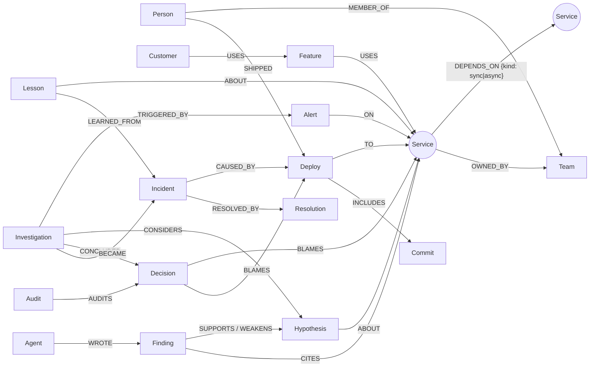

# Blast Radius

[](https://github.com/NehaSama4833/blast-radius/actions/workflows/ci.yml)

**Live site: [blast-radius-lemon.vercel.app](https://blast-radius-lemon.vercel.app/)**. Break something, then press Investigate. If the server has been idle, the site shows a wake-up screen first.

> **Six alerts at 3 AM. None of them is the problem.**


Blast Radius is a team of AI agents that investigates outages by walking a company's **dependency graph in FalkorDB**. The real cause is often a quiet database one hop below everything that is on fire, with no alert of its own. The agents find it, **prove every claim with a graph receipt**, and **test the fix on a copy of the graph** before a human approves it.

Built for Graph Hacks (WeMakeDevs x FalkorDB). Tracks entered:

- **Track 01: Agents That Act on Connected Data**
- **Track 02: Agent Memory and Coordination**

## Four things we’re proud of

| | |
|---|---|
| **We tested FalkorDB itself** | A differential fuzzer ran FalkorDB's path queries and algorithms on 2,000 random graphs against NetworkX and brute force. It found **3 reproducible issues** in FalkorDB 4.18.3, each shrunk to a 3- or 4-node graph: a bounded variable-length pattern that misses reachable nodes on a DAG, paths that are never extended past a repeated node, and `algo.betweenness` returning 0, 1 or 2 where the exact answer is 1. One affected us, and we fixed it. [docs/FALKORDB_FINDINGS.md](docs/FALKORDB_FINDINGS.md) |
| **A real, huge graph** | Two real package ecosystems in FalkorDB: **64,997 PyPI and npm packages, 208,433 dependencies and 6,682,104 real releases**. We replayed **31 real supply-chain incidents**: numpy 2.0, setuptools 72, urllib3 2.0, requests 2.32, the **colors.js sabotage**, the **ua-parser-js hijack**, **node-ipc protestware**, event-stream, is-promise, eslint 9 and more. The culprit release was ranked first in **91 of 93** runs, and in **51 of 51** runs that were never used to tune anything, among ~685 (PyPI) and ~2,600 (npm) releases in the same 48 hours, in about 0.1 s per query. Packages, edges, release times and culprits are real; which dependents fail is simulated. And a security finding from the same graph: **idna has only 59 direct dependents, yet a malicious idna release could reach 24.7% of the top 15,000 PyPI packages within 3 hops** (typing-extensions: 44.5%). [docs/ECOSYSTEMS.md](docs/ECOSYSTEMS.md) |
| **We attacked our own site** | 32 red-team tests: write attempts through the Cypher escape hatch, a YAML "billion laughs" bomb, prompt injection hidden in service names and in the data, `@everyone` pings, IP spoofing to burn the model budget, restarts to reset the daily cap. One test caught a real gap: a hijacked Lead could pick a weaker hypothesis and the Auditor agreed. Now the Auditor flags it. [docs/SECURITY.md](docs/SECURITY.md) |
| **Beat the agents** | Break something, click the service you think did it and lock in your guess, then let the agents race you. Every round is stored in a shared FalkorDB graph, so the page shows humans vs. agents across all visitors. |

## What makes it different

| | |
|---|---|
| **Finds silent culprits** | Ranks every service by how well its failure explains the alerts *and* predicts nothing that is not alerting (coverage x precision over sync paths). Unmonitored stores are first-class suspects. |
| **Five agents, one shared board, inside the graph** | Changes, Impact, History and People work in parallel; their findings are Finding nodes linked to Hypothesis nodes. The Lead's only view is a graph query over that board. |
| **No claim without a receipt** | The server rejects any finding that cites a node the agent never read. Each finding stores the exact tool calls, parameters and graph version. Click it in the UI and the nodes it read light up. |
| **Fix simulated before approval** | `GRAPH.COPY` the graph, apply the proposed rollback/restart, re-run the failure model: "clears 13 of 14 alerts". A human presses Approve. |
| **It remembers** | Resolving writes Incident, Resolution and Lesson nodes. Break the same thing again and the History agent cites what you fixed a minute ago. |
| **Late alerts (Ripple)** | A new alert after the verdict retires only the findings whose receipts it touches; everything else is kept without re-running. |
| **Knows when to say "I don't know"** | When two things broke at once it answers "undetermined" and offers both leads instead of guessing. |
| **Ask the graph** | Type any question ("who should I page about ledger-db right now?"). A small model answers using only read-only graph tools; citations to nodes it never read are dropped, and the receipt shows every query. |
| **Bring your own system** | Paste a `docker-compose.yml`: services become nodes, `depends_on` becomes edges, no healthcheck means unmonitored. Break your own architecture and watch the agents work. |
| **Fact-checked words** | Every service name, deploy id, incident id and number in a verdict, a finding or an Ask answer is checked against the tool results that agent actually read. The UI shows "✓ Fact-checked" or lists what could not be found. |
| **An Auditor that only reads the graph** | A sixth agent shares nothing with the team but the graph: it reads the stored Decision, its BLAMES edges, the board's findings, the stored simulation and fact-check, runs deterministic checks (independent support, deploy before first alert, fix clears most alerts, abstentions stay low-confidence), and writes an Audit node. |
| **Postmortem from memory** | After resolving, one click renders a postmortem (timeline, cause, evidence, hypotheses ruled out, lesson saved) purely from the investigation's nodes. No model writes it, so it cannot invent anything. |
| **Real topology too** | Besides two synthetic companies, the `boutique` world is the service graph of Google's open-source Online Boutique microservices demo (monitoring flags, teams and history are our synthetic additions). |
| **Scales** | Exact branch-and-bound ranking: about 0.4 s for a 28-alert storm in a 2,000-service graph and under 2 s at 10,000 services, same top 5 as scoring everyone ([docs/SCALE.md](docs/SCALE.md)). |
| **Honest benchmark** | Graph agents vs. a docs-only agent with the same facts as Markdown + BM25 search, on 20 held-out scenarios frozen before any test run, plus 60 extended held-out scenarios. The docs-only agent was more accurate on the test split; the [results](#benchmark-results-final-held-out) say so. |

**Try it:** press *Break something at random* (the culprit is hidden from you and the agents), then *Investigate*. Click any service to see what would break if it failed. Every visitor gets a private copy of the company graph.

## Why FalkorDB

| Role | How the graph is used |
|---|---|
| Dependency reasoning | Variable-length sync paths `-[:DEPENDS_ON*0..6 {kind:'sync'}]->` for coverage and blast radius; async edges for lag |
| Graph algorithms | `algo.pageRank` for the most depended-on services. Betweenness is computed exactly in Python over edges read from FalkorDB, because `algo.betweenness` samples ([findings](docs/FALKORDB_FINDINGS.md)) |
| Real data at scale | The PyPI and npm worlds: 6.7 M nodes in all (5.5 M releases in the npm graph alone), one Cypher query per triage (0.06 to 0.11 s median) |
| Shared state | The Beat-the-agents scoreboard is one graph every visitor writes `Round` nodes into |
| Simulation | `GRAPH.COPY` to a scratch graph, apply the fix, re-run the failure model, drop the copy |
| Isolation | One `GRAPH.COPY` sandbox per visitor (2 h TTL, capped), so anyone can break the company safely |
| Coordination | Investigation, Hypothesis, Finding, Decision nodes; the Lead's only view of its team is a graph query |
| Memory | Incident, Resolution and Lesson nodes written on resolve and read back by the History agent; the postmortem is a traversal |
| Provenance | Findings link to every node they cite; receipts store tool, parameters and graph version; Ripple finds stale findings by traversal |
| Search | Full-text index on incident summaries for similar incidents |

Remove FalkorDB and there is no ranking, no board, no memory, no sandbox and no simulation.

**Also an MCP server:** the same 11 graph tools (plus `suspect_releases` for the PyPI and npm worlds) work from Claude Desktop or any MCP client: `python -m mcp_server.server`, or `GRAPH_NAME=pypi` / `GRAPH_NAME=npm` for the real ecosystems (see [mcp_server/server.py](mcp_server/server.py)).

## How it works (one paragraph)

Alerts arrive. The Lead calls `rank_root_causes` (parameterized Cypher finds who can reach whom; plain Python scores coverage x precision) and writes the top 3 hypotheses to the board. Four specialists run in parallel with tools scoped to their role (`recent_changes`, `blast_radius`, `similar_incidents`/`lessons_for`, `find_experts`) and write findings with citations. The Lead reads the board from the graph, decides or abstains, simulates the fix on a graph copy, and drafts a message for Discord. Plain-language tour: [docs/ARCHITECTURE.md](docs/ARCHITECTURE.md). Full design: [docs/DESIGN.md](docs/DESIGN.md).

**Cost:** $0.008 per investigation with Claude (Sonnet 5.5 lead, Haiku 5.5 specialists), against $0.069 for the docs-only baseline on the held-out test split ([results](#benchmark-results-final-held-out)).

## Graph data model



**The company** (loaded from a world generator, one graph per world): `Service {name, layer, tier, language, monitored}`, `Team {name, channel}`, `Person {name, handle, timezone, on_call}`, `Feature {name}`, `Customer {name, plan, arr}`, `Runbook {title, steps}-[:FOR]->Service`, `Deploy {id, ts, kind, summary, diff}`, `Commit {sha, message}` (`Person-[:AUTHORED]->Commit-[:TOUCHES]->Service`), `Alert {id, ts, signal, severity, resolved?}`.
**Memory**: `Incident {id, title, summary, severity, started_at, resolved_at}` (full-text index on `summary`), `Resolution {summary, action, ttr_min}`, `Lesson {pattern, fix, times_seen, last_seen, avg_ttr_min}`, `Person-[:RESPONDED_TO]->Incident`, `Incident-[:AFFECTED]->Service`.
**Coordination** (written by the agents during an investigation): `Investigation {id, ts, status, model}`, `Agent {name}`, `Hypothesis {id, rank, structural_score, status}`, `Finding {id, kind, text, weight, receipt}` (receipt = JSON: tool calls, parameters, graph version, nodes read), `Decision {root_cause, confidence, reasons, actions, receipt, message, verification, faith}`, `Audit {verdict, checks}`. Ripple keeps history with `Finding-[:SUPERSEDED_FOR]->Hypothesis` and `Investigation-[:PREVIOUSLY_CONCLUDED]->Decision`.
**The PyPI and npm worlds** (same labels, real data): `Service` = a package (`downloads_30d`), `DEPENDS_ON {kind:'sync'|'optional'}` = required dependency or extra, `Deploy {kind:'release', version, ts}` = a real release. npm releases also carry `removed` (versions npm took down). Details in [docs/ECOSYSTEMS.md](docs/ECOSYSTEMS.md).
**Game**: the `scoreboard` graph holds one `Round {world, truth, human, agent, human_ok, agent_ok, ts}` per guessed round.
**Sandboxes**: every visitor gets `sbx_<id>`, a `GRAPH.COPY` of the world with a `Meta {world, loaded_at, created_at}` node; simulations use throwaway `sim_<id>` copies.

## Cypher queries and graph algorithms the product depends on

All queries are parameterised templates in `backend/tools/`; models never write Cypher (except the read-only, row-limited `explore_graph` escape hatch, run with `GRAPH.RO_QUERY`).

**Which services could explain the alerts** (`ranking.py`), then scored in Python as coverage x precision:
```cypher
UNWIND $alerting AS name
MATCH (a:Service {name: name})-[:DEPENDS_ON*0..6 {kind: 'sync'}]->(c:Service)
RETURN c.name AS candidate, collect(DISTINCT a.name) AS explains
```
**What each candidate predicts should alert** (precision; evaluated in coverage order with an exact branch-and-bound):
```cypher
UNWIND $c AS cname
MATCH (u:Service {monitored: true})-[:DEPENDS_ON*1..6 {kind: 'sync'}]->(c:Service {name: cname})
RETURN cname, collect(DISTINCT u.name)
```
**Blast radius** (`read.py`): who breaks now (sync), who falls behind (async), features, customers, ARR:
```cypher
MATCH p=(u:Service)-[:DEPENDS_ON*1..6 {kind:'sync'}]->(s:Service {name:$service}) RETURN u.name, min(length(p))
MATCH (f:Feature)-[:USES]->(x:Service) WHERE x.name IN $names RETURN DISTINCT f.name
MATCH (c:Customer)-[:USES]->(f:Feature) WHERE f.name IN $feats RETURN DISTINCT c.name, c.plan, c.arr
```
**Recent changes** on a suspect and what it depends on:
```cypher
UNWIND $services AS n
MATCH p=(s:Service {name:n})-[:DEPENDS_ON*0..2 {kind:'sync'}]->(t:Service)
MATCH (d:Deploy)-[:TO]->(t) WHERE d.ts >= $since AND d.ts <= $until
MATCH (a:Person)-[:SHIPPED]->(d)
RETURN d.id, d.ts, d.kind, d.summary, t.name, a.handle, collect(DISTINCT n), min(length(p))
```
**History**: same root cause, same victims, or similar text (full-text index):
```cypher
MATCH (i:Incident)-[:CAUSED_BY]->(:Deploy)-[:TO]->(root:Service) MATCH (i)-[:RESOLVED_BY]->(r:Resolution) WHERE root.name = $s ...
CALL db.idx.fulltext.queryNodes('Incident', $q) YIELD node, score RETURN node.id, score
MATCH p=(s:Service {name:$s})-[:DEPENDS_ON*0..3 {kind:'sync'}]->(t:Service)<-[:ABOUT]-(l:Lesson)
RETURN l.pattern, l.fix, l.times_seen, l.last_seen, l.avg_ttr_min, t.name, min(length(p)) - 1 AS hops
```
**Who to page**: owners, recent shippers, past responders:
```cypher
MATCH (s:Service {name:$s})-[:OWNED_BY]->(t:Team)<-[:MEMBER_OF]-(p:Person) RETURN p.handle, p.name, p.timezone, p.on_call
MATCH (p:Person)-[:RESPONDED_TO]->(i:Incident)-[:CAUSED_BY]->(:Deploy)-[:TO]->(:Service {name:$s}) RETURN p.handle, count(DISTINCT i)
```
**Critical services**: `CALL algo.pageRank('Service','DEPENDS_ON')`, plus exact betweenness (Brandes) over `MATCH (a:Service)-[:DEPENDS_ON]->(b:Service) RETURN a.name, b.name` (`centrality.py`).
**Supply-chain triage** (`supply_chain.py`, PyPI and npm worlds): which recent release explains the failing packages?
```cypher
UNWIND $failing AS name
MATCH p=(a:Service {name: name})-[:DEPENDS_ON*0..2 {kind: 'sync'}]->(c:Service)
WITH DISTINCT a, c
MATCH (d:Deploy)-[:TO]->(c) WHERE d.ts >= $t0 AND d.ts <= $t1
WITH c, a, max(d.ts) AS last, collect(d.version) AS versions
RETURN c.name, collect(DISTINCT a.name), max(last), head(versions)
```
**Scoreboard** (`main.py`): `CREATE (:Round {world, truth, human, agent, human_ok, agent_ok, ts})` in the shared `scoreboard` graph, read back with one `count`/`sum` query.
**Fix simulation** (`verify.py`): `GRAPH.COPY` to `sim_<id>`, mark the fixed service healthy / the deploy rolled back in the copy, re-run the failure model over the copy's `DEPENDS_ON` edges, drop the copy.
**The Lead's view of the team** (`board.py`, a graph query, not a transcript):
```cypher
MATCH (:Investigation {id:$i})-[:CONSIDERS]->(h:Hypothesis)-[:ABOUT]->(s:Service)
OPTIONAL MATCH (f:Finding)-[r:SUPPORTS|WEAKENS]->(h)
OPTIONAL MATCH (a:Agent)-[:WROTE]->(f)
RETURN h.id, h.rank, h.structural_score, h.status, s.name, f.id, f.kind, f.text, f.weight, type(r), a.name, f.receipt
```
**Memory write-back** (`memory.py`): `CREATE (n:Incident {...}), (i)-[:BECAME]->(n), (n)-[:RESOLVED_BY]->(:Resolution {...}), (n)-[:AFFECTED]->(s)`, then a `Lesson` upsert linked `ABOUT` the service and `LEARNED_FROM` the incident.

## Benchmark results (final, held out)

Copied from [docs/BENCHMARK.md](docs/BENCHMARK.md), which also has the method and the dev-split smoke test.

Final held-out runs, Sat Oct 17 2026 (one run per condition, `--final`, no code changed between runs). Top-1 is over single-cause scenarios (test: 18 of 20; extended: 55 of 60); the rest are two-cause "ambiguous" scenarios, where the right answer is to abstain.

**Test split (20 scenarios, held out)**

| Condition | Top-1 | Top-3 | Deploy found | Invalid citations | Wrong abstentions | Correct abstentions | Cost (total / per run) | Mean latency |
|---|---|---|---|---|---|---|---|---|
| A graph-llm | 0.833 (15/18) | 1.000 | 0.778 | 3 | 2 | 2/2 | $0.157 / $0.008 | 13.2 s |
| B docs-llm | **0.944 (17/18)** | 0.944 | **0.944** | 0 | 1 | 1/2 | $1.389 / $0.069 | 16.3 s |
| graph-rules (floor, no LLM) | 0.889 (16/18) | 1.000 | 0.889 | 0 | 0 | 2/2 | $0 | 0.14 s |
| graph-coverage-only (ablation) | 0.722 (13/18) | 0.778 | 0.722 | 0 | 0 | 2/2 | $0 | 0.13 s |

**Extended split (60 scenarios, held out; docs-llm not run for cost)**

| Condition | Top-1 | Top-3 | Deploy found | Invalid citations | Wrong abstentions | Correct abstentions | Cost | Mean latency |
|---|---|---|---|---|---|---|---|---|
| A graph-llm | 0.873 (48/55) | 0.982 | 0.818 | 0 | 1 | 5/5 | $0.466 | 11.9 s |
| graph-rules (floor) | 0.873 | 0.982 | 0.873 | 0 | 0 | 5/5 | $0 | 0.12 s |
| graph-coverage-only | 0.727 | 0.855 | 0.727 | 0 | 0 | 5/5 | $0 | 0.13 s |

By tier on the test split (top-1): easy graph-llm 0.75 / docs-llm 1.00 / rules 1.00; medium 1.00 / 1.00 / 1.00; hard 0.75 / 0.875 / 0.75. On the extended split (graph-llm and graph-rules identical): easy 1.00, medium 1.00, hard 0.731 (26 scenarios).

### What this says, plainly
- **The docs-only agent was more accurate than our graph agent on the test split** (top-1 0.944 vs 0.833; 3 scenarios apart on n=18, which is a small, noisy difference). We do not claim the graph agent is more accurate. The docs agent also abstained wrongly once and missed one of two ambiguous cases.
- **The graph agent was about 9x cheaper per investigation** ($0.008 vs $0.069) and slightly faster (13.2 s vs 16.3 s mean).
- **The graph agent made 3 invalid citations on the test split** (the docs agent, which cites documents, had none). The server's citation check rejects these before they are stored; they are counted here because the agent attempted them. It made 0 on the extended split.
- **The LLM did not beat the deterministic no-LLM policy.** graph-rules matched or beat graph-llm on both splits (test 0.889 vs 0.833; extended 0.873 vs 0.873) at zero cost. Most of the accuracy comes from the graph ranking, not the model.
- **Ranking by coverage x precision matters:** coverage-only is clearly worse (0.722 test, 0.727 extended) than graph-rules.
- **Where everything struggles:** hard scenarios (0.73 to 0.88 top-1). On the extended split, all of the misses are hard scenarios or two-cause cases, and 5 of 7 single-cause misses are in the `boutique` world, the one no rule or prompt was tuned on.
- Total spend for all final runs: about $2.01 (graph-llm $0.157 + $0.466, docs-llm $1.389).

Per-scenario results, including every miss, are in `bench/results/test-*.json` and `bench/results/extended-*.json`.

## Reproduce every number

| Claim | Command | Write-up |
|---|---|---|
| graph agents vs docs-only, held-out | `python -m bench.run --split test --condition graph-llm --final` (and `docs-llm`, `graph-rules`, `graph-coverage-only`; `--split extended` for the 60-scenario set) | [docs/BENCHMARK.md](docs/BENCHMARK.md) |
| practice-split smoke test | `python -m bench.run --split dev --condition graph-llm` | [docs/BENCHMARK.md](docs/BENCHMARK.md) |
| ranking at 2,000 / 10,000 services | `python -m bench.scale --services 2000` | [docs/SCALE.md](docs/SCALE.md) |
| pruning never changes the top 5 | `pytest backend/tests/test_ranking.py -k branch` | |
| scenario files are frozen | `pytest backend/tests/test_failure_model.py -k frozen` | |
| FalkorDB differential fuzz (2,000 graphs) | `python -m bench.fuzz_falkordb --graphs 2000 --seed 20261017` | [docs/FALKORDB_FINDINGS.md](docs/FALKORDB_FINDINGS.md) |
| the 3 FalkorDB reproductions | `python -m bench.falkordb_repros` (or `FALKORDB_URL=... ` for a server) | [docs/FALKORDB_FINDINGS.md](docs/FALKORDB_FINDINGS.md) |
| 21 real PyPI incidents | `python -m bench.pypi_incidents --split dev` and `--split test` | [docs/ECOSYSTEMS.md](docs/ECOSYSTEMS.md) |
| hijack blast radius (PyPI, npm) | `python -m bench.hijack_radius` | [docs/ECOSYSTEMS.md](docs/ECOSYSTEMS.md) |
| attacks on our own site (red-team tests) | `pytest backend/tests/test_security.py` | [docs/SECURITY.md](docs/SECURITY.md) |
| 10 real npm incidents (5.5 M releases) | `python scripts/fetch_npm.py --max 50000` then `python -m bench.npm_incidents` (or the committed slice, same results) | [docs/ECOSYSTEMS.md](docs/ECOSYSTEMS.md) |

The held-out runner refuses to run without `--final`, and the scenario files are checked against their generator by a test, so nobody can tune on them by accident.

## Setup

Two ways: everything local (below), or the hosted setup in [docs/DEPLOY.md](docs/DEPLOY.md) (FalkorDB Cloud + Render + Vercel). Copy `.env.example` to `.env` and fill in what you need; with no model key the app runs with the deterministic rule policy.

## Run the tests

```bash
python -m venv .venv && . .venv/bin/activate
pip install -r requirements.txt
pytest backend/tests
```

Tests use the embedded `falkordblite` by default. To test against a real server set `FALKORDB_URL=redis://localhost:6379` (CI uses the `falkordb/falkordb` Docker image).

## Run the web screen

```bash
uvicorn backend.app.main:app --port 8000      # API
cd frontend && npm install && npm run dev      # UI on http://localhost:5173 (proxies /api)
```

## Windows note

`falkordblite` (the embedded database) does not run on Windows, so on Windows use a FalkorDB server instead and set `FALKORDB_URL`:

```powershell
docker run -p 6379:6379 falkordb/falkordb        # needs Docker Desktop
$env:FALKORDB_URL = "redis://localhost:6379"
pytest backend/tests
```

No Docker? Create a free instance at FalkorDB Cloud and use its connection string as `FALKORDB_URL`.

## AI assistance disclosure

I'm Neha Sharma, and I built this project with the help of an AI assistant, **Claude** (Anthropic). Claude wrote most of the code, tests and documentation from my design and decisions. I reviewed, tested and directed the work, and I can explain the graph model, the queries and the architecture.

At runtime the agents use Claude models (Sonnet 5.5 lead, Haiku 5.5 specialists) through the Anthropic API; without a key the app falls back to a deterministic rule policy, so the demo never depends on the model. All benchmark numbers come from the scripts listed above, never from a model's text.

## License

MIT, see [LICENSE](LICENSE).

